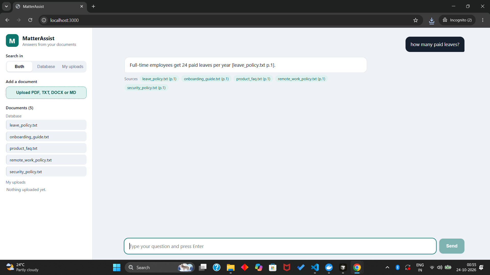
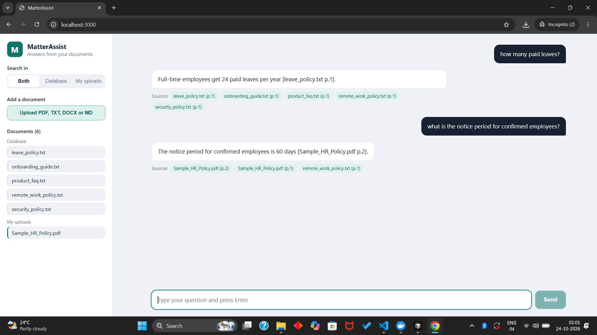
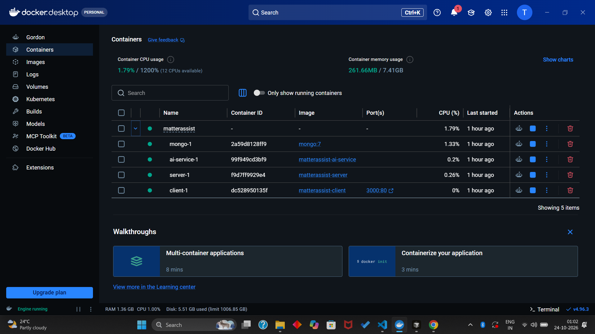

# MatterAssist: Document-Aware Chatbot

A chatbot that answers questions from your documents. It searches a pre-loaded document database and files you upload, then answers using only the retrieved content and shows the sources it used.






**Live demo:** <PASTE_LIVE_URL>
**Docker image:** `docker pull thehardikgupta>/matterassist-client` (see "Run with Docker")

## Features
- Chat UI with session history (persists across page refresh)
- Upload PDF, TXT, DOCX or MD files
- Pre-loaded database of sample documents
- Retrieval-grounded answers (RAG) with source names shown
- Streaming responses
- Scope selector: Database, My uploads, or Both
- Fully containerised with Docker Compose

## Architecture

```
Browser (React + Vite, served by nginx)
        |
        v   /api/*
Node.js + Express server  <---->  MongoDB (sessions, chat history, document metadata)
        |
        v
Python AI service (LangChain)  --->  Gemini (embeddings + answer generation)
```

| Service | Tech | Job |
|---|---|---|
| client | React, Vite, nginx | Chat UI, upload, scope selector |
| server | Node.js, Express | REST API, sessions, history, file upload, streams answers to the UI |
| ai-service | Python, LangChain, Gemini | Chunking, embeddings, retrieval, answer generation |
| mongo | MongoDB 7 | Persistent storage |

### How a question is answered
1. The UI sends the question, session id and scope to `/api/chat`.
2. The server forwards it to the AI service.
3. The AI service retrieves the most relevant chunks from the selected scope.
4. Gemini answers using only those chunks.
5. Tokens stream back to the UI, followed by the source list.

## Setup

### Prerequisites
- Docker Desktop
- A Gemini API key (https://aistudio.google.com/apikey)

### Run with Docker (recommended)
```bash
git clone https://github.com/Hardikgupta0106/matterassist.git
cd matterassist
cp .env.example .env        # Windows PowerShell: copy .env.example .env
# open .env and set GEMINI_API_KEY=your_key
docker compose up --build
```
Open http://localhost:3000

### Run without Docker (development)
```bash
# terminal 1: server
cd server && npm install && npm run dev
# terminal 2: ai-service
cd ai-service && pip install -r requirements.txt && python main.py
# terminal 3: client
cd client && npm install && npm run dev
```
Open http://localhost:5173

## How to test
1. Open the app and ask: `How many paid leaves?` The answer should come from the pre-loaded policy documents and show a source.
2. Upload `Sample_HR_Policy.pdf` (included in `samples/`).
3. Switch scope to "My uploads" and ask: `What is the notice period for confirmed employees?` Expected: 60 days.
4. Ask something not in any document, for example `Who won the cricket world cup?` The bot should say it cannot find this in the documents.
5. Refresh the page. Your chat history should still be there.

## Design decisions
- **RAG instead of fine-tuning:** documents change often, and retrieval keeps answers traceable to a source.
- **Separate AI service:** keeps Python-based LangChain tooling apart from the Node API, so each part can be changed or scaled on its own.
- **Server-Sent Events for streaming:** simple, works through nginx, no WebSocket setup needed.
- **Session id in the browser:** no login required for the assignment; uploads and history are scoped to the session.
- **Scope selector:** documents are tagged as `db` or `upload`, so retrieval can filter by scope.

## Limitations
- No user accounts; sessions are tied to one browser.
- Scanned PDFs (images without text) are not supported without OCR.
- Answer quality depends on chunking and the Gemini model used.
- Large files may take time to index.

## Possible improvements
- Add authentication and per-user document libraries
- OCR for scanned documents
- Hybrid search (keyword + vector) and re-ranking
- Show highlighted source passages in the UI
- Automated tests and CI

## Project structure
```
matterassist/
  client/        React UI
  server/        Express API
  ai-service/    Python RAG service
  samples/       Sample documents for testing
  docker-compose.yml
  .env.example
```

## Environment variables
Copy `.env.example` to `.env`. Never commit `.env`.

| Variable | Purpose |
|---|---|
| GEMINI_API_KEY | Gemini API key |
